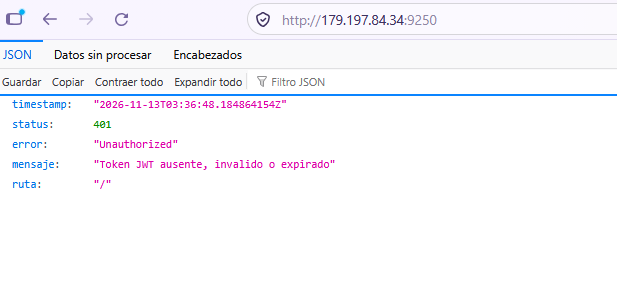
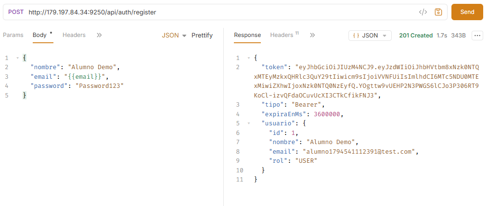
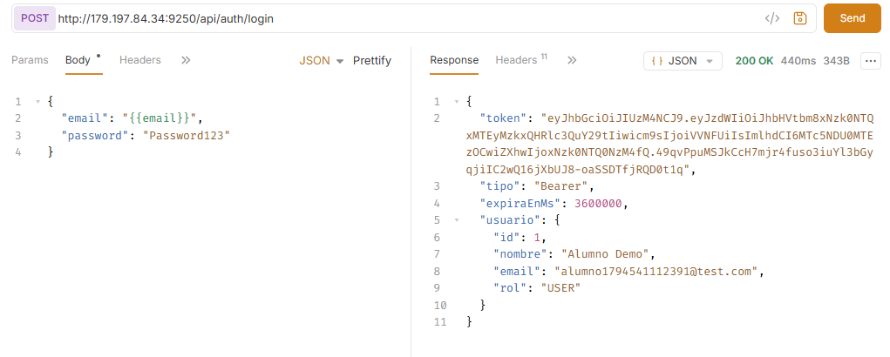
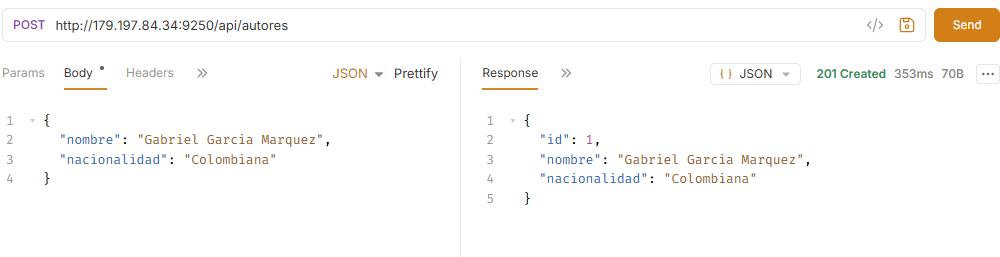
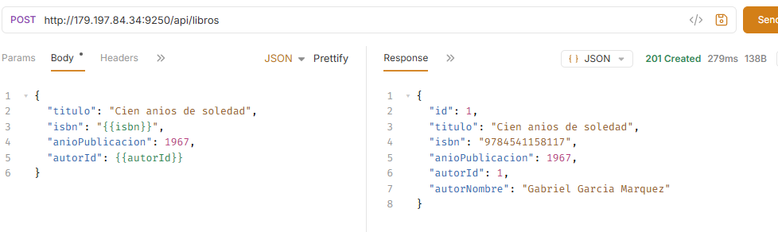
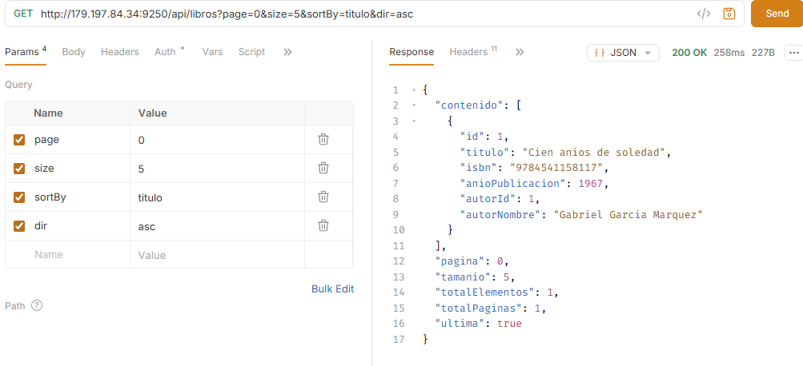
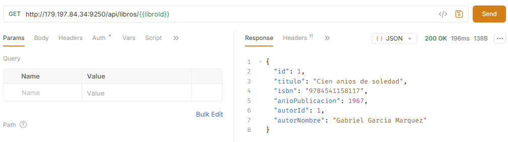
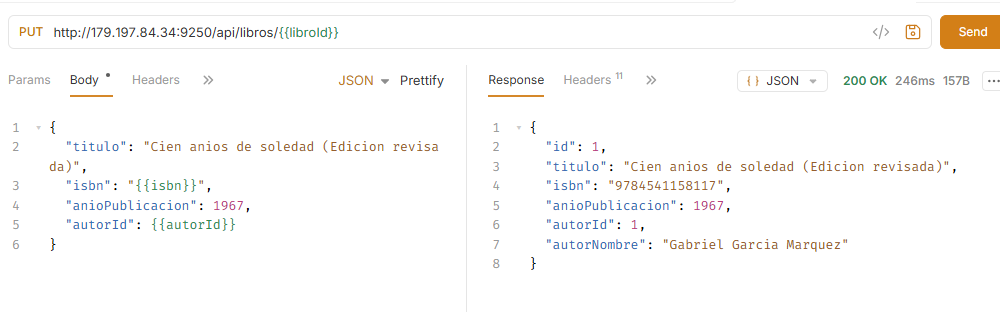
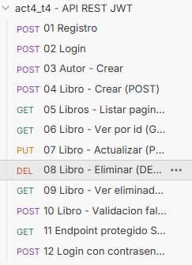

# act4_t4 · API REST con Spring Boot, Spring Security y JWT


API REST pura (sin vistas) para gestionar **libros y autores**, protegida con **autenticación real mediante Spring Security + JWT**, con DTOs, validación de entrada, paginación, MySQL y una colección de pruebas en **Bruno**.

> Actividad 4 · Ingeniería en Sistemas Computacionales · Tecnológico Nacional de México
> Autor: _(escribe aquí tu nombre)_ · Grupo 8SA · Puerto de despliegue: **9250**

---

## Tabla de contenidos
1. [Tecnologías utilizadas](#1-tecnologías-utilizadas)
2. [Arquitectura](#2-arquitectura)
3. [Requisitos previos](#3-requisitos-previos)
4. [Comandos en Windows](#4-comandos-en-windows)
5. [Cómo ejecutar el proyecto (paso a paso)](#5-cómo-ejecutar-el-proyecto-paso-a-paso)
6. [Referencia de la API](#6-referencia-de-la-api)
7. [Pruebas con Bruno](#7-pruebas-con-bruno)
8. [Despliegue en el VPS](#8-despliegue-en-el-vps)
9. [Capturas de pantalla](#9-capturas-de-pantalla)
10. [Solución de problemas](#10-solución-de-problemas)
11. [Documentación adicional](#11-documentación-adicional)

---

## 1. Tecnologías utilizadas

Cada tecnología se explica con: **qué es**, **para qué sirve**, **cómo se configuró** y **cómo se usa en este proyecto**.

### Java 17
- **Qué es:** lenguaje y plataforma de ejecución (JDK). Versión LTS.
- **Para qué sirve:** base de todo el backend. Se usan `record` (Java 16+) para los DTOs.
- **Configuración:** `<java.version>17</java.version>` en `pom.xml`.

### Maven
- **Qué es:** gestor de dependencias y de construcción.
- **Para qué sirve:** descarga librerías y empaqueta la app en un `.jar` ejecutable.
- **Configuración:** `pom.xml` (parent `spring-boot-starter-parent` 3.3.5 + `spring-boot-maven-plugin`).
- **Uso:** `mvn spring-boot:run` (desarrollo) y `mvn clean package` (genera `target/act4-t4-1.0.0.jar`).

### Spring Boot 3.3
- **Qué es:** framework que autoconfigura una aplicación Spring lista para ejecutar (servidor Tomcat embebido incluido).
- **Para qué sirve:** reduce la configuración manual; arranca con `@SpringBootApplication`.
- **Uso:** clase `Act4Application`. Todo se configura en `src/main/resources/application.properties`.

### Spring Web (`spring-boot-starter-web`)
- **Qué es:** módulo para construir APIs HTTP/REST.
- **Uso:** `@RestController`, `@GetMapping`, `@PostMapping`, `@PutMapping`, `@DeleteMapping` y `ResponseEntity` para controlar el código de estado (200, 201, 204, 400, 401, 404, 409). Siempre responde JSON.

### Spring Data JPA + Hibernate
- **Qué es:** capa de persistencia. JPA es el estándar de mapeo objeto-relacional; Hibernate es la implementación.
- **Para qué sirve:** guardar y consultar objetos Java en tablas sin escribir SQL.
- **Configuración:** `spring.jpa.hibernate.ddl-auto=update` (crea/actualiza tablas automáticamente) y `spring.jpa.open-in-view=false` (buena práctica: el acceso a datos ocurre dentro de los servicios con `@Transactional`).
- **Uso:** entidades `Usuario`, `Autor`, `Libro` (en `entity/`), repositorios que extienden `JpaRepository` (en `repository/`). La relación **N:1** está en `Libro` con `@ManyToOne` + `@JoinColumn(name = "autor_id")`. La paginación usa `Pageable`/`Page`.

### MySQL 8 + MySQL Connector/J
- **Qué es:** base de datos relacional y su driver JDBC.
- **Configuración:** `spring.datasource.url|username|password`, leídas de **variables de entorno** (`DB_URL`, `DB_USERNAME`, `DB_PASSWORD`) con valores por defecto para desarrollo local. La BD `biblioteca_act4` se crea sola gracias a `createDatabaseIfNotExist=true`.

### Spring Security 6
- **Qué es:** framework de autenticación y autorización.
- **Para qué sirve:** decidir quién puede entrar a qué ruta.
- **Configuración (`config/SecurityConfig.java`):**
  - Sesión **stateless** (no hay cookies de sesión; todo va en el token).
  - CSRF desactivado (válido en APIs con token en cabecera, sin cookies).
  - Públicas: `POST /api/auth/register` y `POST /api/auth/login`. **Todo lo demás exige autenticación.**
  - `UserDetailsService` que busca el usuario en MySQL por email.
  - `JsonSecurityHandlers`: responde 401/403 en JSON.
- **Uso:** el filtro JWT se registra *antes* de `UsernamePasswordAuthenticationFilter`.

### BCrypt
- **Qué es:** algoritmo de hash con sal para contraseñas.
- **Uso:** `BCryptPasswordEncoder`. En la BD solo se guarda el hash; el password **nunca** se devuelve en respuestas (los DTOs de respuesta no lo contienen).

### JWT con jjwt 0.12.6
- **Qué es:** JSON Web Token, un token firmado con tres partes (`header.payload.firma`) que prueba la identidad sin guardar sesión en el servidor.
- **Para qué sirve:** tras el login, el cliente envía `Authorization: Bearer <token>` en cada petición.
- **Configuración:** `jwt.secret` (clave Base64 ≥ 256 bits, variable `JWT_SECRET`) y `jwt.expiration-ms` (por defecto 1 hora).
- **Uso:** `JwtService` genera/valida con HMAC-SHA256; `JwtAuthenticationFilter` lee el header, valida y autentica. Detalle completo en [`docs/SEGURIDAD_JWT.md`](docs/SEGURIDAD_JWT.md).

### Bean Validation (`spring-boot-starter-validation`)
- **Qué es:** validación declarativa con anotaciones (`@NotBlank`, `@Email`, `@Size`, `@Min`, `@NotNull`).
- **Uso:** las anotaciones están en los DTOs de petición y se activan con `@Valid` en el controlador. Si fallan, `GlobalExceptionHandler` responde **400** con un mapa `campo → mensaje`.

### DTOs (`record`)
- **Qué son:** objetos que definen exactamente qué entra y qué sale de la API.
- **Uso:** `LibroRequest`/`LibroResponse`, `RegisterRequest`, `LoginRequest`, `AuthResponse`, `UsuarioResponse`, etc. Evitan exponer entidades (y el password).

### Manejo global de errores (`@RestControllerAdvice`)
- Un solo lugar (`GlobalExceptionHandler`) transforma excepciones en JSON uniforme (`ApiError`): 400, 401, 404, 409, 500.

### Bruno
- **Qué es:** cliente de APIs open source, sin cuenta, que guarda las peticiones como archivos de texto (`.bru`).
- **Uso:** la colección está en [`/bruno`](bruno/) y se versiona con el código. Ver [`docs/BRUNO.md`](docs/BRUNO.md).

### Git y `.gitignore`
- El `.gitignore` excluye `target/`, `.jar`, IDEs, logs, `.env` y archivos con secretos.

---

## 2. Arquitectura

### Capas (patrón Controller → Service → Repository)

```
Cliente (Bruno / curl)
        │  HTTP + JSON  (Authorization: Bearer <JWT>)
        ▼
┌──────────────────────────────────────────────┐
│ Filtros de Spring Security                   │
│  └─ JwtAuthenticationFilter (valida token)   │
└──────────────────────────────────────────────┘
        ▼
┌──────────────┐   DTOs    ┌──────────────┐   Entities   ┌──────────────┐     ┌───────┐
│ Controller   │ ───────▶  │ Service      │ ───────────▶ │ Repository   │ ──▶ │ MySQL │
│ (REST, @Valid│           │ (lógica de   │              │ (JpaRepository│    │       │
│  ResponseEnt.)│ ◀─────── │  negocio)    │ ◀─────────── │  )           │ ◀── │       │
└──────────────┘           └──────────────┘              └──────────────┘     └───────┘
        ▲
 GlobalExceptionHandler (errores → JSON)
```

### Flujo de autenticación JWT

```
1) POST /api/auth/register  ─▶ se guarda usuario (password con BCrypt) ─▶ 201 + token
2) POST /api/auth/login     ─▶ AuthenticationManager valida credenciales ─▶ 200 + token
3) GET  /api/libros  + header "Authorization: Bearer <token>"
      └▶ JwtAuthenticationFilter valida firma y expiración
          ├─ válido   ─▶ acceso al controlador (200/201/204…)
          └─ inválido ─▶ 401 Unauthorized (JSON)
```

### Modelo de datos

```
usuarios (id, nombre, email UNIQUE, password[hash], rol)

autores  (id, nombre, nacionalidad)
   ▲ 1
   │
   │ N
libros   (id, titulo, isbn UNIQUE, anio_publicacion, autor_id FK → autores.id)
```

### Estructura del proyecto

```
act4_t4/
├── bruno/                       # Colección Bruno (12 peticiones + entornos local/vps)
├── docs/                        # Documentación adicional y capturas
│   ├── SEGURIDAD_JWT.md
│   ├── BRUNO.md
│   ├── DESPLIEGUE_VPS.md
│   └── capturas/
├── src/main/java/com/tecnm/act4/
│   ├── Act4Application.java
│   ├── config/SecurityConfig.java
│   ├── security/                # JwtService, JwtAuthenticationFilter, JsonSecurityHandlers
│   ├── controller/              # AuthController, AutorController, LibroController
│   ├── service/                 # AuthService, AutorService, LibroService
│   ├── repository/              # UsuarioRepository, AutorRepository, LibroRepository
│   ├── entity/                  # Usuario, Autor, Libro, Rol
│   ├── dto/                     # Requests/Responses, PageResponse, ApiError
│   └── exception/               # Excepciones propias + GlobalExceptionHandler
├── src/main/resources/application.properties
├── pom.xml
└── .gitignore
```

---

## 3. Requisitos previos

| Herramienta | Versión | Cómo obtenerla |
|---|---|---|
| JDK | **17** o superior | https://adoptium.net (Temurin 17, instalador `.msi`; marca "Set JAVA_HOME") |
| Maven | **3.9+** | https://maven.apache.org/download.cgi → descomprime y agrega `bin` al `PATH` |
| MySQL Server | **8.0+** (o MariaDB 10.6+) | https://dev.mysql.com/downloads/installer/ |
| Bruno | última | https://www.usebruno.com/downloads |
| Git | 2.40+ | https://git-scm.com/download/win |
| IDE (opcional) | VS Code + _Extension Pack for Java_ | https://code.visualstudio.com |

---

## 4. Comandos en Windows

Ejecuta en **PowerShell**:

```powershell
# Verificar instalación
java -version
mvn -version
mysql --version
git --version

# Clonar el proyecto
git clone https://github.com/TUUSUARIO/TUSINICIALESact4_t4.git
cd TUSINICIALESact4_t4

# Variables de entorno (solo para esta sesión de PowerShell)
$env:DB_URL      = "jdbc:mysql://localhost:3306/biblioteca_act4?createDatabaseIfNotExist=true&useSSL=false&allowPublicKeyRetrieval=true&serverTimezone=UTC"
$env:DB_USERNAME = "root"
$env:DB_PASSWORD = "tu_password_mysql"
$env:JWT_SECRET  = "<clave Base64 de 32+ bytes>"   # opcional en local

# Generar una clave JWT segura (Base64 de 48 bytes aleatorios)
[Convert]::ToBase64String((1..48 | ForEach-Object { Get-Random -Maximum 256 }) -as [byte[]])

# Ejecutar en desarrollo
mvn spring-boot:run

# Compilar el .jar
mvn clean package -DskipTests

# Ejecutar el .jar
java -jar target\act4-t4-1.0.0.jar

# Cambiar el puerto si hiciera falta
$env:SERVER_PORT = "9250"
```

---

## 5. Cómo ejecutar el proyecto (paso a paso)

1. **Instala** JDK 17, Maven, MySQL y Bruno (sección 3).
2. **Inicia MySQL** (en Windows aparece como servicio `MySQL80`; verifícalo en `services.msc`).
3. **Clona** el repositorio y entra a la carpeta (sección 4).
4. **Define las variables de entorno** `DB_USERNAME` y `DB_PASSWORD` con tus credenciales de MySQL. La base `biblioteca_act4` y sus tablas se crean solas al primer arranque.
5. **Arranca** con `mvn spring-boot:run`. Debes ver `Tomcat started on port 9250`.
6. **Verifica** que la API rechaza peticiones sin token:
   ```powershell
   curl.exe -i http://localhost:9250/api/libros     # → HTTP/1.1 401
   ```
7. **Abre Bruno** → *Open Collection* → carpeta `bruno/` → entorno **local** → ejecuta la colección en orden (`01` a `12`).

---

## 6. Referencia de la API

Base URL local: `http://localhost:9250`

| Método | Ruta | Auth | Descripción | Éxito | Errores |
|---|---|---|---|---|---|
| POST | `/api/auth/register` | No | Registra usuario y devuelve token | 201 | 400, 409 |
| POST | `/api/auth/login` | No | Inicia sesión y devuelve token | 200 | 400, 401 |
| POST | `/api/autores` | JWT | Crea autor | 201 | 400, 401 |
| GET | `/api/autores?page=&size=` | JWT | Lista autores paginados | 200 | 401 |
| GET | `/api/autores/{id}` | JWT | Autor por id | 200 | 401, 404 |
| GET | `/api/libros?page=0&size=10&sortBy=titulo&dir=asc` | JWT | Lista libros **paginados** | 200 | 401 |
| GET | `/api/libros/{id}` | JWT | Libro por id (incluye `autorNombre`) | 200 | 401, 404 |
| POST | `/api/libros` | JWT | Crea libro | 201 | 400, 401, 404, 409 |
| PUT | `/api/libros/{id}` | JWT | Actualiza libro | 200 | 400, 401, 404, 409 |
| DELETE | `/api/libros/{id}` | JWT | Elimina libro | 204 | 401, 404 |

**Ejemplo de registro**
```json
POST /api/auth/register
{ "nombre": "Ana", "email": "ana@correo.com", "password": "Password123" }
```
```json
201 Created
{ "token": "eyJhbGciOi...", "tipo": "Bearer", "expiraEnMs": 3600000,
  "usuario": { "id": 1, "nombre": "Ana", "email": "ana@correo.com", "rol": "USER" } }
```

**Ejemplo de error de validación (400)**
```json
{ "timestamp": "2026-11-11T18:00:00Z", "status": 400, "error": "Bad Request",
  "mensaje": "Datos de entrada invalidos", "ruta": "/api/libros",
  "errores": { "titulo": "El titulo es obligatorio", "isbn": "El ISBN debe tener entre 10 y 17 caracteres" } }
```

**Códigos usados:** 200 OK · 201 Created · 204 No Content · 400 Bad Request (validación/JSON inválido) · 401 Unauthorized (sin token, token inválido/expirado, login incorrecto) · 404 Not Found · 409 Conflict (email o ISBN duplicado) · 500 Internal Server Error.

---

## 7. Pruebas con Bruno

La colección `bruno/` contiene: registro, login, crear autor, **4 operaciones CRUD** (POST, GET lista paginada, GET por id, PUT, DELETE), un 404 tras eliminar, una validación fallida (400), una petición **sin token (401)** y un login incorrecto (401). Los scripts guardan automáticamente el `token`, `autorId` y `libroId`. Entornos: `local` y `vps`. Guía: [`docs/BRUNO.md`](docs/BRUNO.md).















pruebas 

---

## 8. Despliegue en el VPS

Resumen: compilar `.jar` → subir a una carpeta nueva → crear BD y usuario MySQL → exportar variables → `nohup java -jar` en el puerto **9250** sin tocar las actividades 1, 2 y 3. Pasos completos en [`docs/DESPLIEGUE_VPS.md`](docs/DESPLIEGUE_VPS.md).

---

## 9. Capturas de pantalla

Guarda las imágenes en `docs/capturas/` y enlázalas aquí:

| Evidencia | Archivo |
|---|---|
| Registro | `` |
| Login | `` |
| POST crear libro | `` |
| GET listar (paginado) / por id | `` |
| PUT actualizar | `` |
| DELETE eliminar | `` |
| Petición sin token → 401 | `` |
| Pruebas contra el VPS | `` |

---

## 10. Solución de problemas

| Síntoma | Causa probable | Solución |
|---|---|---|
| `Access denied for user 'root'` | Credenciales incorrectas | Revisa `DB_USERNAME`/`DB_PASSWORD` |
| `Communications link failure` | MySQL apagado o URL mal | Inicia el servicio y revisa `DB_URL` |
| `Port 9250 was already in use` | Otro proceso usa el puerto | `netstat -ano \| findstr 9250` y cierra el proceso, o cambia `SERVER_PORT` |
| Las tablas no aparecen | Base distinta a la configurada | Verifica el nombre en `DB_URL`; ejecuta `USE biblioteca_act4; SHOW TABLES;` |
| 401 con token recién generado | Token expirado, o falta el prefijo `Bearer ` | Haz login de nuevo; revisa el header |
| `WeakKeyException` | `JWT_SECRET` menor a 256 bits | Genera una clave de 32+ bytes en Base64 |

---

## 11. Documentación adicional
- [`docs/SEGURIDAD_JWT.md`](docs/SEGURIDAD_JWT.md) — cómo funciona la seguridad por dentro.
- [`docs/BRUNO.md`](docs/BRUNO.md) — uso de la colección.
